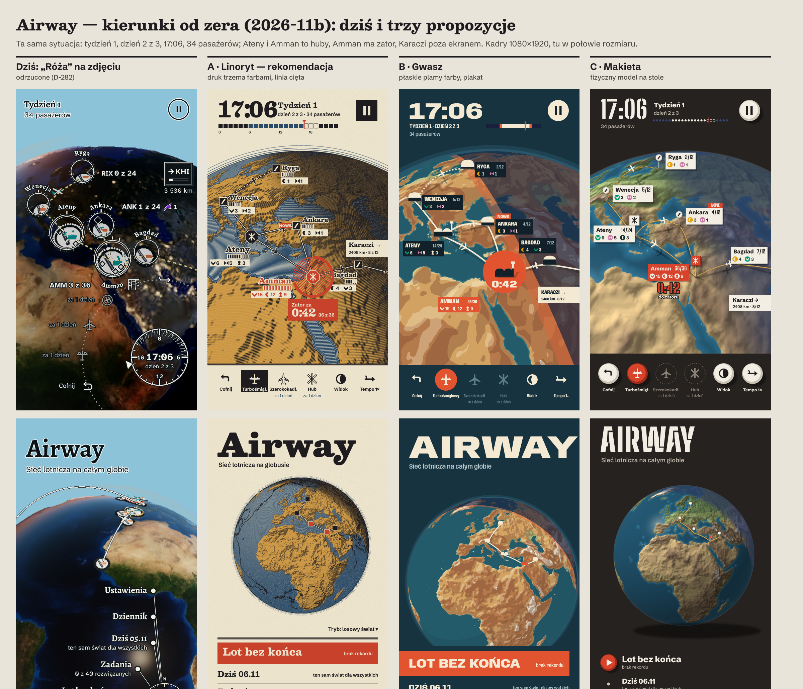
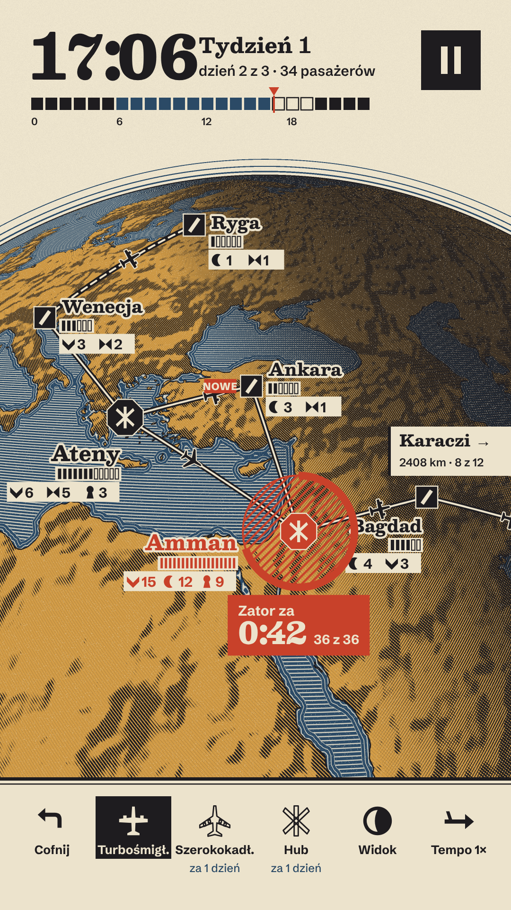
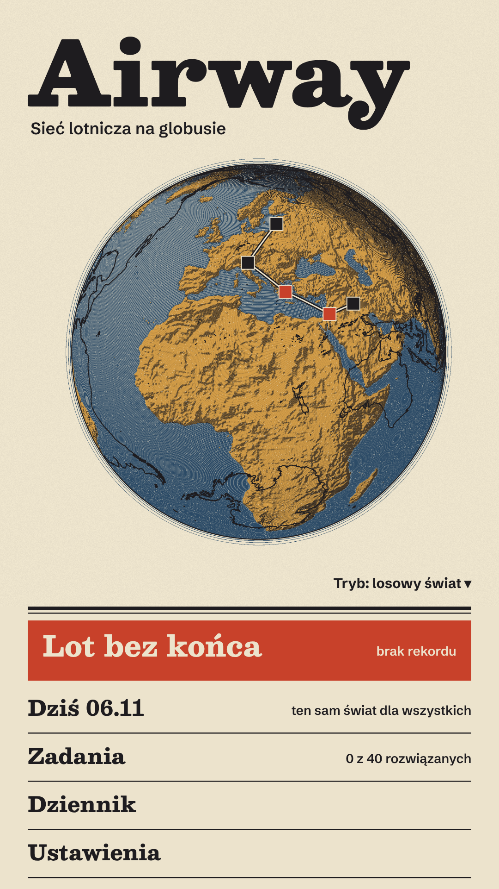
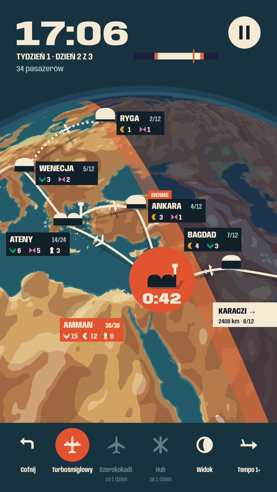
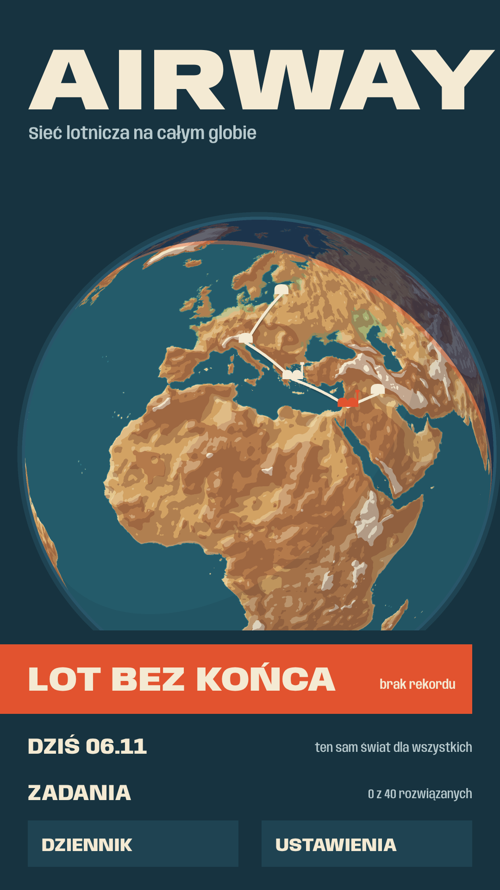
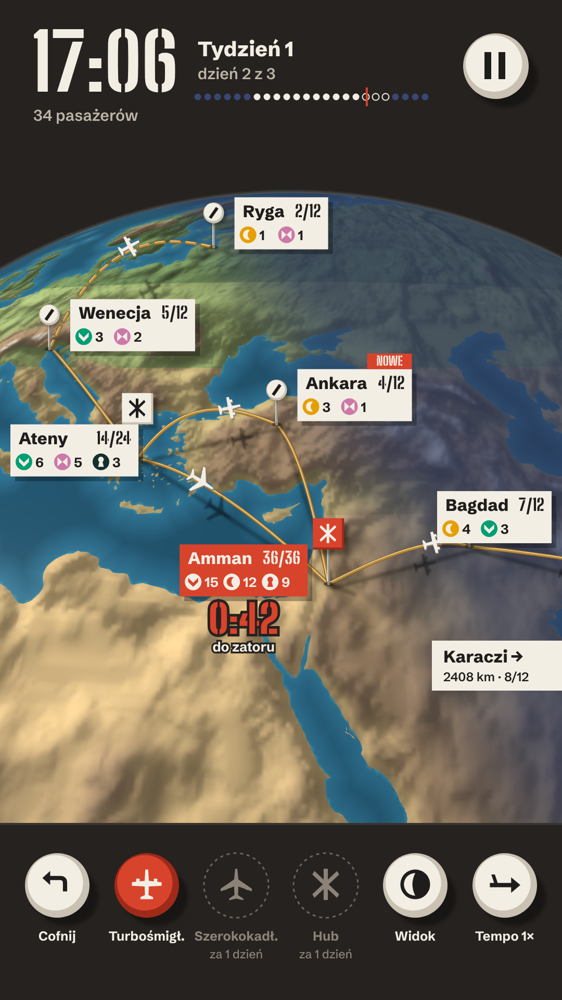
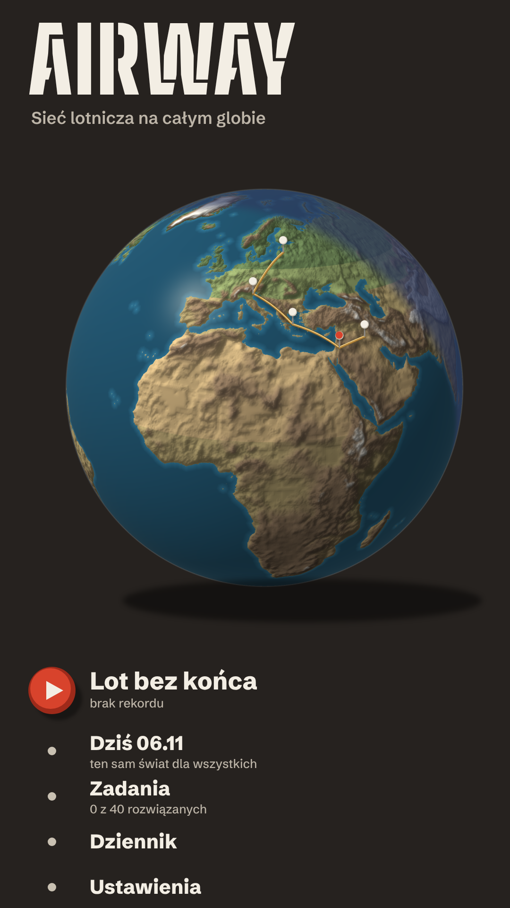

# Airway: trzy kierunki oprawy od zera (noc 27a, 2026-11-06)

**Kadry (PNG 1080×1920, skala 1):** `docs/styles/kierunki-2026-11b/png/`
`a-game.png`, `a-menu.png` (A Linoryt) · `b-game.png`, `b-menu.png` (B Gwasz) · `c-game.png`, `c-menu.png`
(C Makieta) · `zestawienie.png` (dziś + A/B/C, gra i menu).
Research: [`RESEARCH.md`](RESEARCH.md). Decyzja do podjęcia: **D-282**.

**Jak powstały.** Każdy kadr to nasz własny rysunek, a nie zrzut gry. Globus liczę piksel po pikselu z prawdziwych
danych gry (ląd Natural Earth z `world-atlas`, rzeźba ETOPO5 z `public/data/globe/elevation-2048.png`), z kamery
podobnej do kadru sklepowego. W żadnym kadrze nie ma zdjęcia satelitarnego. Trasy, samoloty, lotniska i UI to SVG.
Sytuacja jak na `game-phone.png`: tydzień 1, dzień 2 z 3, 17:06, 34 pasażerów; Ateny i Amman to huby, **Amman ma
zator** (0:42 do zamknięcia), Ankara jest nowa, Karaczi jest poza ekranem, wybrany jest turbośmigłowiec,
szerokokadłubowiec i hub będą „za 1 dzień”. Odtworzenie: `npm ci`, potem
`node docs/styles/kierunki-2026-11b/src/shoot.mjs` (wszystko) albo `… shoot.mjs a|b|c|sheet [game|menu]`.

---

## Diagnoza: dlaczego dzisiejsze cztery warstwy czytają się jak „slop”

Dobre gry z researchu mają jedną wspólną cechę: **świat i UI są narysowane jedną techniką** (Obra Dinn: 1 bit,
DEFCON: wektor, Pentiment: drzeworyt, Inscryption: przedmioty na stole), z **krótką paletą** i **informacją
rysowaną kształtem w świecie**. U nas każda warstwa ma inną technikę, a żadna nie jest nasza:

1. **Globus = cudze zdjęcie.** Blue Marble widział każdy (tapety, prezentacje, stocki). To najmocniejszy obraz na
   ekranie i nie my go zrobiliśmy, więc cała gra wygląda jak „szablon na zdjęciu Ziemi”. Fotografia ma też własne
   kolory (brąz, granat, czerń nocy), z którymi żadna farba UI nie rozmawia.
2. **Ornamenty „Róży” to metafora, a nie technika.** Róża kompasowa w menu, tarcza zegara, cienkie linie
   odniesienia i pierścienie wokół lotnisk to cienkie białe linie wektorowe położone na zdjęciu. Opowiadają o mapie
   lotniczej, ale nie są narysowane jak mapa; to dekoracja, którą da się zdjąć bez straty informacji (znak slopu nr 2).
3. **Typografia i panele = domyślny UI kit.** Szeryf z miękkim cieniem „pływa” po zdjęciu, bo nie ma na czym być
   wydrukowany. Ciemne arkusze z przerywanymi liniami i obramowane przyciski (skrzynie, raport porażki) to trzeci
   język obok zdjęcia i ornamentu.
4. **Lotniska i samoloty mieszają rozdzielczości.** Medalion to rozmyty, pikselowy krążek z pasem i budynkiem w 3D,
   obok ostrych wektorowych pierścieni i płaskich ikon samolotów z jednego zestawu. Trzy rozdzielczości w jednym
   obiekcie to klasyczny znak „asset flipu”.

Wzór poprzednich rund (Diorama → satelita → KARTA → KARTA v2 → Róża): za każdym razem zmienialiśmy **metaforę**
(papier, karta, róża) i dokładaliśmy ozdoby na to samo zdjęcie. Dlatego teraz każdy kierunek zaczyna od **techniki
rysowania globusa**, a UI dziedziczy ją 1:1.

**Wspólne dla A, B i C.** Globus bez zdjęcia: kolor, rzeźba i noc liczone w shaderze z naszych danych. Dok na dole w
zasięgu kciuka, każdy cel ≥ 48 dp (126 px na 1080 px szerokości), pauza w rogu. Hub różni się od zwykłego lotniska
**kształtem** (A: ośmiokąt vs kwadrat; B: podwójny hangar z wieżą vs hangar; C: kwadratowa plakietka vs okrągła
główka szpilki). Pasażerowie zachowują glify D-08, pogrupowane z liczbą. Zator ma własny, nie do pomylenia kształt.
Na żadnym ekranie nie ma róży kompasowej, tarczy zegara, ciemnych półprzezroczystych arkuszy, gradientów ani poświaty.
Czas to pasek doby (godziny nocne wyróżnione), a nie tarcza.

---

## A. Linoryt: cały ekran to jeden druk w trzech farbach (rekomendacja)

**Idea w jednym zdaniu.** Globus i interfejs są wycięte w linoleum i odbite trzema farbami na papierze: morze to
blok pruskiego błękitu z wyciętymi białymi liniami, ląd to ochra z czarnym kreskowaniem rzeźby, noc to czarne
kreskowanie krzyżowe, a czerwień zostaje tylko dla alarmu.

**Referencje (zasada, nie kopia).** Return of the Obra Dinn: jedna technika na wszystko i walka z migotaniem
wzoru w ruchu. Pentiment: druk jako źródło stylu i fonty z tego samego świata. 80 Days: globus jako plansza w
jednym stylu z UI. DEFCON: świat i UI tą samą linią. Water-lining z map XIX w.: morze opisane liniami wzdłuż
brzegu. Imhof: światło z północnego zachodu. Risografia: 3 farby i ziarno papieru.

**Cztery warstwy.**
1. *Globus / świat.* Papierowe niebo z trzema drukowanymi liniami atmosfery i atramentowym brzegiem tarczy. Morze:
   trzy wycięte linie wzdłuż wybrzeża, dalej drobne linie wzdłuż równoleżników, grubsze tam, gdzie pada światło
   (kulistość z samej linii). Ląd: ochra, kreskowanie skośne tylko na stokach odwróconych od światła, linia brzegu
   czarna. Noc: kreskowanie krzyżowe gęstnieje za terminatorem (dwie warstwy kresek), więc noc **czyta się jak
   cisza nocna**, a nie jak czarna plama. Trasy to podwójna linia (czarna z papierowym środkiem) jak droga na starej
   mapie; trasa planowana jest przerywana.
2. *Ornamenty.* Nie ma ich: każda linia coś znaczy (brzeg, trasa, rzeźba, noc, czas).
3. *Typografia i panele.* **Besley** (szeryf w typie Clarendon, krój „czcionki drewnianej”) na zegar, tydzień i
   nazwy; **Schibsted Grotesk** na teksty i liczby. Tekst jest wydrukowany na papierowym marginesie albo ma papierowy
   „wybrany” obrys, nigdy cień. Panele to papier z podwójną linią (ramka druku); jedyny wypełniony blok w kadrze to
   czerwony zator. Wybrany przycisk to czarny wycięty blok z papierowym znakiem, a niedostępny to sam kontur.
4. *Lotniska i samoloty.* Lotnisko to **czarny stempel**: kwadrat z wyciętym pasem (zwykłe) albo ośmiokąt z trzema
   pasami (hub). Zapełnienie to **rząd wyciętych kresek** pod nazwą (1 kreska = 2 miejsca; pełna = zajęta), a obok
   pasażerowie (glif + liczba). Zator: czerwony nadruk, czyli zakreskowana strefa wokół huba, gruby łuk to czas do
   zamknięcia i blok „Zator za 0:42, 36 z 36”. Samolot to czarna sylwetka z papierowym obrysem (turbośmigłowy:
   prosty płat i dwa silniki; szerokokadłubowy: skośne skrzydło i cztery silniki; obie sylwetki narysowane dla
   Airway).

**Paleta.** Papier `#ECE3CC` · atrament `#1E1C1F` · pruski błękit `#2B4A66` · ochra `#D29C47` · czerwień `#C8412A`.
Glify pasażerów są drukowane atramentem (kształt niesie znaczenie); kolory D-08 mogą wrócić jako czwarta farba,
jeśli test na telefonie pokaże, że sam kształt nie wystarcza.
**Ruch.** Krótki i rzeczowy: samoloty jadą po trasie bez wygładzonego „bujania”, nowa trasa „odbija się” jako linia
rysowana od początku do końca w 200 ms, zator pulsuje grubością łuku (bez zmiany skali), noc przesuwa się razem z
kreskowaniem. Żadnych sprężyn.
**Menu.**  Duży tytuł Besley, pod nim globus jak rycina, a niżej spis jak w książce:
„Lot bez końca” na czerwonym bloku, pozostałe pozycje rozdzielone liniami, każda ≥ 48 dp.

**Co się zmienia.**
- `src/render/**` (sesja globusa, tu tylko opis): nowy materiał globusa `look: 'linoryt'` (shader: maska lądu,
  odległość od brzegu, rzeźba; kreski liczone w przestrzeni lat/lon, czyli nie pływają przy obrocie; dwie
  częstotliwości kresek przenikające się wraz z zoomem; antyaliasing przez `fwidth`); tło nieba = kolor papieru
  zamiast `DIORAMA_SKY`; usunięcie tekstur Blue Marble i Black Marble z buildu; lotniska jako płaskie stemple
  (instancjonowane quady z jednej atlasowej tekstury SVG) zamiast medalionów 3D; trasy jako podwójna linia; samoloty
  jako sprite'y; noc jako kreskowanie w tym samym shaderze.
- `src/ui/**`: nowa skórka (`skin/linoryt.css`, tokeny palety, 2 fonty WOFF2 z licencjami), HUD (zegar + pasek doby
  zamiast tarczy), dok (stemple), notatki lotnisk w `overlay.ts` (kreski miejsc, glify), ekrany skrzyń, porażki,
  pauzy i ustawień w tym samym druku (te ekrany **nie** są jeszcze narysowane).

**Ryzyko na telefonach.** Shader jest tani (kilka `smoothstep` na piksel, jedna tekstura odległości ~0,5 MB), a
całość jest lżejsza niż dziś: znikają chmury, ocean i mgiełka jako osobne przezroczyste powłoki oraz ~1,8 MB
zdjęć (D-171). Główne ryzyko to **migotanie drobnych kresek** w ruchu i przy zoomie na słabych GPU oraz moiré na
ekranach o niskiej gęstości. Lekarstwo: kreski w przestrzeni obiektu, dwie oktawy z przenikaniem i minimalna
grubość 1,5 px (lekcja z Obra Dinn). Drugie ryzyko: gęsta sieć na kreskowanym lądzie. Trzeba to zmierzyć na
budżetowym telefonie (SwiftShader w kontenerze tego nie pokaże).

## B. Gwasz: ekran to jeden plakat malowany płaską farbą

**Idea w jednym zdaniu.** Globus widziany z ukosa jak na mapach Harrisona dla „Fortune”, malowany kilkoma
nieprzezroczystymi plamami bez linii: rzeźba w trzech stopniach jasności, płytka woda jaśniejsza, terminator jako
ciepły pas farby, noc jako jedna indygo laserunek; trasy i samoloty unoszą się nad globusem i rzucają płaski cień.

**Referencje.** R. E. Harrison (perspektywiczny globus, sieć Pan Am 1936), plakaty lotnicze 1930–70 i Polska
Szkoła Plakatu dla LOT (jedna idea, płaska plama), Imhof (stopnie światła rzeźby), Alto's Odyssey i Monument Valley
(krótka paleta na scenę, pora dnia jako nastrój), Bad North i ISLANDERS (kilka płaskich kolorów, bez tekstur).

**Cztery warstwy.**
1. *Globus.* Głęboki łupkowy błękit nieba z dwoma płaskimi pasami atmosfery. Morze: dwa kolory (szelf i głębia).
   Ląd: 4 pasy wysokości (nizina, wyżyna, góry, szczyty; zieleń na północ od 44°) × 3 stopnie światła; jeden
   ciemniejszy stopień na odwróconej stronie kuli. Noc i zmierzch to płaskie plamy (pomarańczowy pas = zmierzch, gdy
   rośnie popyt). Trasy: kremowe wstęgi uniesione nad globusem z płaskim cieniem na ziemi (wysokość widać po
   cieniu); trasa planowana jest kropkowana.
2. *Ornamenty.* Brak linii w ogóle; wszystko jest plamą.
3. *Typografia i panele.* **Anybody** (jedna rodzina o zmiennej szerokości: szeroki do zegara i tytułu, wąski do
   nazw). Etykiety lotnisk to płaskie, wycięte prostokąty farby (ink `#122129`) bez obrysu, linii i cienia; zator
   to ten sam prostokąt w cynobrze. Dok to dolny pas tej samej farby co niebo, z kremowymi znakami, a wybrany ma
   cynobrowe koło.
4. *Lotniska i samoloty.* Lotnisko to **sylwetka hangaru** (łuk), hub to **podwójny hangar z wieżą**. Zapełnienie =
   **poziom ciemnej farby w hangarze** (hangar napełnia się pasażerami jak naczynie). Zator: cynobrowe koło za hubem
   z dużym „0:42”. Samoloty to kremowe sylwetki w powietrzu z płaskim cieniem na globusie.

**Paleta.** Niebo `#173340`, pasy `#1F4352` `#29566A` · morze `#245B6A` / szelf `#2F7682` · ląd `#E3C68E`
`#D2A263` `#B47A4B` `#F1E5CC`, zieleń `#A7AF73` · noc `#18203D`, zmierzch `#E2643A` · krem `#F4EAD3` ·
cynober `#E2532F` · atrament `#122129`. Glify pasażerów w kolorach D-08 (CVD-sprawdzone).
**Ruch.** Płaskie przesunięcia, cień trasy „odkleja się” od ziemi, gdy samolot startuje, hangar napełnia się
skokami (nie płynnym gradientem), zator to jedno uderzenie koła na minutę gry.
**Menu.**  Szeroki napis AIRWAY przez całą szerokość, globus jako bohater plakatu,
„Lot bez końca” na cynobrowym pasie, reszta jako duże litery.

**Co się zmienia.** `src/render/**`: materiał `look: 'gwasz'` (posteryzacja z wygładzonej mapy wysokości i
hillshade'u, tablica palety 1D, noc i zmierzch jako płaskie progi), płaskie tło nieba, wstęgi tras z cieniem
(2 wywołania rysowania), hangary jako płaskie sprite'y z maską poziomu. `src/ui/**`: skórka `gwasz.css`, 1 font,
HUD (zegar + pasek doby z trzech plam), dok, etykiety w `overlay.ts`, menu, ekrany skrzyń i porażki w tym samym
plakacie.
**Ryzyko.** Najtańszy z trzech (kilka progów w shaderze i mała tekstura palety). Ryzyko wizualne: posteryzacja
mapy 2048 daje „plamy moro”, jeśli nie wygładzimy wysokości i nie wygładzimy krawędzi progów; płaska ilustracja
wektorowa łatwo osuwa się w „stockowy flat design”. Ciemne prostokąty etykiet mogą zostać odebrane jako znów
„pudełka”. Kierunek był kiedyś blisko stylu AirWar (D-06); tu nie ma cyrku, slabu ani naklejek, ale to trzeba
pilnować.

## C. Makieta: globus jako ręcznie zrobiony model na stole

**Idea w jednym zdaniu.** Globus to rzeźbiony gipsowy model z morzem z błyszczącej żywicy, oświetlony jedną ciepłą
lampą z lewej góry i chłodną lampą po stronie nocy; lotniska to emaliowane szpilki z papierowymi chorągiewkami,
trasy to mosiężne druty nad powierzchnią z prawdziwymi cieniami, a UI to te same emaliowane żetony i kalkomanie.

**Referencje.** Hitman GO i Lara Croft GO (gra jako diorama), Bad North, Townscaper i Tiny Glade (jedno światło i
model zamiast assetów), Inscryption (wszystko jest przedmiotem na stole), Berann (przesadzona rzeźba dla
czytelności). Plansze planistów lotniczych ze szpilkami i nitką to motyw znany, ale tu jest rzeźbą, nie naklejką.

**Cztery warstwy.**
1. *Globus.* Ciemny stół `#26221F`; kolory biomów pomalowane ręcznie (pustynia, step, umiarkowany, las, skała,
   śnieg), rzeźba przesadzona i oświetlona; morze z połyskiem i jaśniejszym szelfem. Noc to chłodne światło
   `#384774` zamiast czerni.
2. *Ornamenty.* Brak; jedyne „dodatki” to cienie obiektów od tej samej lampy.
3. *Typografia i panele.* **Big Shoulders Stencil Display** (szablonowe cyfry jak kalkomanie na modelach) do zegara,
   liczb i tytułu, **Schibsted Grotesk** do tekstów. Etykiety to papierowe chorągiewki na szpilkach z twardym
   cieniem lampy (bez zaokrągleń i miękkich „domyślnych” cieni). Dok to sześć emaliowanych żetonów, wybrany jest
   czerwony, a niedostępny to przerywany ślad po żetonie.
4. *Lotniska i samoloty.* Zwykłe lotnisko to szpilka z okrągłą główką i pasem; hub to szpilka z kwadratową plakietką
   z trzema pasami. Zapełnienie to liczba i glify na chorągiewce. Zator to czerwona szpilka i chorągiewka plus duże
   „0:42”. Samoloty to małe odlewy z cieniem na globusie.

**Paleta.** Stół `#26221F` · pustynia `#DDBE88` · step `#C4B07A` · umiarkowany `#97A86C` · las `#728C5A` · skała
`#A68A6C` · śnieg `#EEE9DE` · morze `#2C6C8A` / głębia `#1F4F68` / szelf `#3E8BA2` · noc `#384774` · emalia
`#F3EEE4` · mosiądz `#B98A3E` · czerwień `#D8432C`.
**Ruch.** Fizyczny, ale krótki: szpilka „wbija się” 120 ms, druty lekko się napinają przy dodaniu trasy, cienie
idą za lampą-słońcem.
**Menu.**  Globus na stole z cieniem, tytuł jako kalkomania, lista z czerwonym żetonem
„graj”.

**Co się zmienia.** `src/render/**`: oświetlony materiał z mapą normalnych z rzeźby (żeby nie było schodków,
potrzebna jest mapa ≥ 4096, czyli +1–1,5 MB), połysk morza, cienie szpilek, drutów i samolotów (rzutowane sprite'y
albo dodatkowy pass), lotniska jako małe modele 3D. `src/ui/**`: skórka `makieta.css`, 1 nowy font, żetony,
chorągiewki w `overlay.ts`, menu, ekrany.
**Ryzyko.** Najdroższy (oświetlenie per piksel, połysk, cienie, większe tekstury) i najbliższy dzisiejszej
technice, czyli realistycznemu 3D. Mapa wysokości 2048 przy zbliżeniu daje schodki (widać to w kadrze), czyli ten
sam problem „pikselowości”, który odrzuciłeś. Wizualnie najłatwiej tu o „generic 3D mobile”: błyszczący globus z
plastikowymi pinezkami.

---

## Rekomendacja: A „Linoryt”

1. **Jedyny w pełni nasz.** Żadna gra o sieciach ani o globusie nie wygląda jak druk z linoleum. Obra Dinn i
   Pentiment pokazują, że taka jedna, konsekwentna technika jest odbierana jako autorska. B jest bezpieczny, ale
   płaska ilustracja jest wszędzie. C jest najbliżej tego, co już odrzuciłeś (realistyczne 3D).
2. **Jedna technika na cztery warstwy.** Globus, trasy, lotniska, samoloty, czcionki i panele to ta sama farba na
   tym samym papierze. Nie ma czego „nakładać na zdjęcie”, więc znika główna przyczyna slopu.
3. **Grafika tłumaczy rozgrywkę.** Noc jest kreskowaniem, które gęstnieje (cisza nocna widoczna jako gęstość), hub
   różni się stemplem, zapełnienie to wycięte kreski, a zator to jedyny czerwony nadruk na ekranie.
4. **Lżejszy dla telefonów niż dziś** (bez zdjęć 4096 i bez trzech przezroczystych powłok); ryzyko migotania kresek
   jest znane i ma znane rozwiązanie.
5. **Nie jest minimalny (D-05):** rzeźba, wybrzeża, morze i noc są gęsto narysowane; to bogaty świat, tylko
   jedną ręką.

B warto zostawić jako plan awaryjny, jeśli test A na budżetowym telefonie pokaże migotanie albo nieczytelność.

## Samokontrola (CLAUDE.md, lista zakazów i lista slopu z RESEARCH.md)
Każdy PNG obejrzany po renderze, w kilku iteracjach (poprawki: kamera, pikselowe wybrzeża, plamy rzeźby, nakładające
się etykiety, ucięte menu). Brak przedrostka „Mini”, brak kolorowych linii na pastelowym tle, brak kół, kwadratów i
trójkątów jako pasażerów (glify D-08), brak wyglądu planu metra. Brak fioletowo-niebieskich gradientów,
glassmorphismu, neonowej poświaty, zaokrąglonych kart z domyślnym cieniem, emoji, ikon z jednego zestawu (wszystkie
symbole narysowane dla Airway w `src/icons.js`), Inter/Roboto/systemowego fontu, wyśrodkowanego „Welcome”, wykresów
z dashboardu i clipartowych samolotów czy globusów (globus liczony z danych). Typy różnią się kształtem, cele mają
≥ 48 dp, dok jest w zasięgu kciuka. Uczciwie: C ma miękkie cienie obiektów (to światło sceny, nie cień UI), a B ma
płaskie prostokąty etykiet; oba punkty opisałem wyżej jako ryzyka.

## Czego nie zrobiłem / otwarte pytania
- Narysowane są tylko gra w pionie i menu. **Nie ma** kadrów poziomych, składanego telefonu, ekranu skrzyń, porażki
  ani nocy; po wyborze kierunku to pierwszy krok.
- Pytania do Ciebie: (1) Który kierunek: A, B czy C (albo A z paletą B)? (2) W A: czy glify pasażerów mogą być
  jednym atramentem (sam kształt), czy wracamy do kolorów D-08 jako czwartej farby? (3) Czy przy tej zmianie
  rezygnujemy całkiem z trybu „Satelita” (D-170/D-172), czy zostaje jako ustawienie?
- Nagranie wideo do sklepu i zrzuty sklepowe czekają na wybór (D-282).
