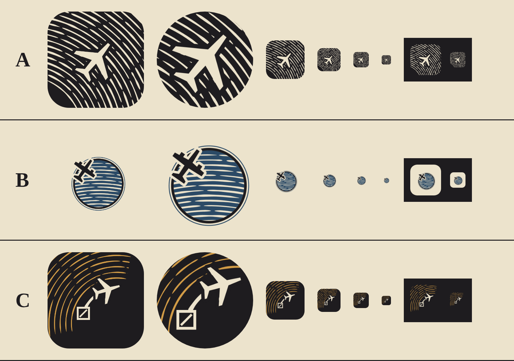

# Znak aplikacji jako linoryt: trzy szkice do oceny (U7, D-317)

Szkic, nie wdrożenie. Ikon w `android/` i `ios/` nie ruszałem. Wszystkie pliki są w tym katalogu i powstają z
`node docs/styles/kierunki-2026-11b/src/app-icon.mjs`:
- SVG 1024×1024 i PNG każdego wariantu, bez spadu, pod maskę systemu;
- `zestawienie-znak.png`, czyli podgląd w masce iOS (zaokrąglony kwadrat), w masce adaptacyjnej Androida (koło,
  widoczny środek 72/108) oraz w rozmiarach 120, 72, 48 i 29 px, także na ciemnym tle.

Technika jak w grze: jeden klocek tuszu na papierze, farby tylko z §1 specyfikacji (papier, tusz, błękit, ochra;
czerwieni nie ma, bo oznacza tylko korek). Samolot to sylwetka z symboli doku (`src/icons.js`), wycięta w tuszu, z
pasem tuszu dookoła, jak przy wycinaniu dłutem. Linie to ślady dłuta o nierównej, zwężającej się szerokości.
Wszystko ważne mieści się w bezpiecznej strefie Androida (66/108).

## A. „Odbitka” (rekomendacja)
Cały kafel to tusz. Z klocka wycięte są równoleżniki globu, którego środek leży poza kaflem, i poprzecznie do nich
szerokokadłubowiec lecący na północny wschód.
- Plusy: najmocniejsza sylwetka w 48 i 29 px. Czytelny na jasnym i ciemnym tle. Jest w nim cała technika gry
  (wycięcie, dłuto, równoleżniki), a nie widać „globusa z samolotem”.
- Minusy: w 29 px równoleżniki zlewają się w szarą fakturę. Sam samolot zostaje czytelny.

## B. „Nad kulą”
Papierowy kafel, niebieska kula z papierowymi równoleżnikami i tuszowym brzegiem. Turbośmigłowiec w tuszu z
papierową obwódką, dokładnie jak sprite samolotu w grze (D-304), przecina brzeg kuli.
- Plusy: najbliżej obrazu z gry.
- Minusy: kula musi zmieścić się w strefie Androida, więc na iOS jest mała. W 48 px zostaje niebieska plamka.
  Układ „samolot nad globusem” jest blisko kliszy biur podróży, a lista zakazów w CLAUDE.md zabrania clipartowych
  samolotów i globusów. Nie polecam.

## C. „Trasa”
Tusz. Papierowa trasa po łuku wielkiego koła biegnie od stempla lotniska (kwadrat jak w grze) do samolotu. W tle
ochrowe ślady dłuta.
- Plusy: opowiada główny ruch gry (narysuj trasę, samolot leci sam).
- Minusy: trzy elementy na małym polu, więc w 48 px stempel i trasa się gubią. Ochra na tuszu w małych rozmiarach
  wygląda jak szum.

## Samokontrola (lista zakazów z CLAUDE.md)
- Brak gradientów, glassmorphismu, poświaty, emoji i stockowych ikon.
- Sylwetki są nasze (symbole doku). Brak przedrostka „Mini”, kolorowych linii na pastelowym tle i wyglądu mapy metra.
- Brak tekstu, więc żaden font nie jest potrzebny.
- Ryzyko „clipartowego samolotu i globusa” dotyczy wariantu B, opisane wyżej.

## Do decyzji właściciela
Który wariant rozwinąć do ikon wydania (Android adaptacyjna z warstwą tła i pierwszego planu oraz monochromatyczna
dla Androida 13+, iOS 1024 i tryby ciemny/tinted na iOS 18)? Rekomendacja: **A**. Po wyborze trzeba osobnego zadania:
wygenerować zasoby do `android/` i `ios/` oraz podmienić grafiki w sklepach (U7).
