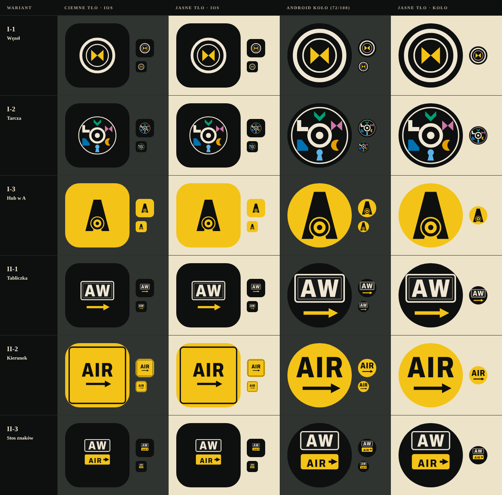

# Znak aplikacji Airway: sześć szkiców w języku UI-A (D-323)

Szkic, nie wdrożenie. Ikon w `android/` i `ios/` nie ruszałem. Poprzednie szkice znaku (linoryt, D-317) są odrzucone
wraz z całym Linorytem; z `kierunki-2026-11b/znak/` wziąłem tylko lekcję: żadnego „samolotu nad globusem”, żadnej
tekstury na polu, żadnych drobnych elementów, które w 48 px zlewają się w szum.

Pliki: `znak-i-1…3.svg/.png`, `znak-ii-1…3.svg/.png` (1024×1024, pełne pole bez spadu pod maskę systemu), zestawienie
`zestawienie-znak-2026-11c.png` (ciemne i jasne tło, iOS zaokrąglony kwadrat, maska kołowa Androida z widocznymi
72/108, rozmiary 48 i 29 px). Źródło: `node docs/styles/kierunki-2026-11c/znak/src/znak.mjs`; napisy są zamienione na
kontury (Archivo 800, SIL OFL, `src/glyphs.py`), więc SVG nie potrzebuje fontu. Paleta wyłącznie z UI-A: czerń emalii
`#0E0F0F`, krem `#EFE7D3`, żółty znak kierunku `#F3C317`; w drodze I dodatkowo kolory glifów D-08. Czerwień zatoru
celowo nie występuje w znaku (oznacza tylko zator). Cała treść mieści się w bezpiecznym kole Androida (66/108).

## Droga I: z huba i glifów pasażerów (D-08)
- **I-1 „Węzeł”.** Czarna emalia, gruby i cienki pierścień huba w kremie, w środku glif kokardka (D-08) w żółtym
  „dokąd”. Dwie trasy spotykające się w węźle. Plusy: najprostszy, najmocniejszy w 48 i 29 px, nie ma w nim ani
  globu, ani samolotu, ani nic z Mini Metro (pierścień huba jest naszym znakiem z gry). Minus: kokardka z pierścieniem
  bywa czytana jako „klepsydra w tarczy”, więc nazwa gry musi być obok w sklepie.
- **I-2 „Tarcza”.** Ten sam podwójny pierścień jako tarcza, w której szczelinie siedzą wszystkie sześć glifów D-08 w
  kolorach regionów. Plusy: opowiada grę (kształt = kierunek), jedyny kolorowy wariant. Minusy: w 48 px glify
  zamieniają się w kolorowy szum, a sześć kształtów w kole zalatuje loterią. Najsłabszy z szóstki; zostawiam jako
  materiał do plakatu, nie do ikony.
- **I-3 „Hub w A”.** Żółte pole jak tabliczka kierunku, czarna litera A zbudowana z dwóch nóg (dwie trasy), a jej
  poprzeczką jest podwójny pierścień huba wycięty w tuszu. Plusy: litera marki i znak z gry w jednym, mocna sylwetka.
  Minusy: bryła A jest ciężka (trochę trapez lub dzwon), pierścień w 29 px to kropka; ostra żółć na ekranie
  głównym jest głośna.

## Droga II: ze znaku lotniskowego (tabliczka z kodem)
- **II-1 „Tabliczka”.** Czarna emalia, krem na czerni jak znak lotniska w UI-A: tabliczka z podwójną ramką i kodem
  **AW**, pod nią żółta strzałka trasy. Plusy: wprost ten sam język co gra (tabliczki lotnisk, żółty = dokąd), czytelne
  w 48 px (kod AW nadal się czyta), bez żadnego clipartu. Minusy: litery to wciąż font (Archivo), więc znak jest mniej
  „narysowany”; poziomy napis jest mały na tle pola.
- **II-2 „Kierunek”.** Żółte pole z czarną obwódką jak znak kierunku (czarny na żółtym), napis **AIR** i strzałka.
  Plusy: największy kontrast i największe litery, czyta się nawet w 29 px. Minusy: „AIR” to skrót generyczny,
  ramka wychodzi poza bezpieczne pole (w masce kołowej się ucina, co nie szkodzi, bo to dekor), mało własny.
- **II-3 „Stos znaków”.** Czarne pole, tabliczka lokalizacji **AW** (krem) nad żółtym znakiem kierunku **AIR →**,
  tak jak stoją razem prawdziwe znaki na drodze kołowania. Plusy: pełny język ICAO, najbogatszy znak z drogi II.
  Minus: w 48 px dolny pasek AIR jest za drobny, w 29 px zostaje sam AW.

## Samokontrola (CLAUDE.md i D-323)
Trzy rundy poprawek po obejrzeniu PNG. Co poprawiłem: (1) pierwszy węzeł z asteryskiem i żółtym promieniem wyglądał
jak płatek śniegu z wskaźnikiem, zastąpiony czystą kokardką; (2) „podwójne V” z dwóch szewronów wyglądało jak logo
nietoperza, zastąpione literą A z hubem; (3) „Trzy kierunki” rozlatywały się jak medal, zastąpione tarczą;
(4) tabliczki zmniejszone, by rogi nie wychodziły z maski kołowej; (5) usunięty szpic w kontrze A. Sprawdzone:
brak gradientów, neonu, szkła, poświaty, emoji, kart SaaS, globu i samolotu, brak fioletu i błękitu jako tła, brak
przedrostka „Mini”, brak układu mapy metra. Kolory żółty i krem są z UI-A, kroje OFL. Ryzyko wspólne całej drogi II:
żółto-czarny znak drogowy jest też językiem wielu stron o lotniskach, więc bez własnego rysunku (jak I-1) łatwo
zostać „znakiem lotniska”.

## Rekomendacja
1. **I-1 „Węzeł”** jako znak aplikacji: jedyny w pełni własny i najczytelniejszy w małych rozmiarach. Pierścień huba
   to ten sam obiekt, który gracz buduje, a kokardka D-08 w żółtym mówi „dokąd”.
2. **II-1 „Tabliczka”** jako wariant zapasowy lub znak sklepu (grafika funkcji, nagłówek strony), bo wprost wiąże znak
   z oprawą UI-A i daje nazwę AW.
3. I-2, II-2 i II-3 odpadają jako ikona; I-3 jest ciekawa, ale ciężka. Decyzja należy do właściciela. Po wyborze trzeba
   osobnego zadania: zasoby `android/` (tło, pierwszy plan, monochromatyczny) i `ios/` (domyślny, ciemny, tinted),
   sklepy i strona (U7).
