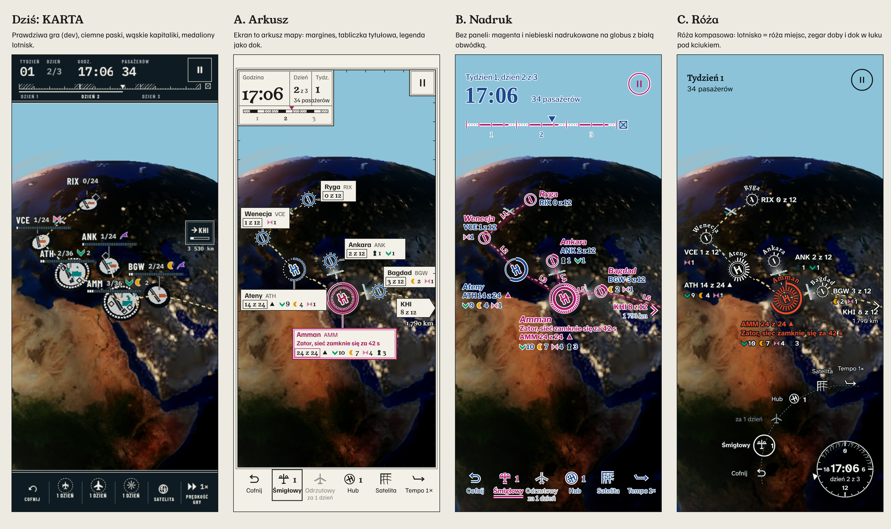
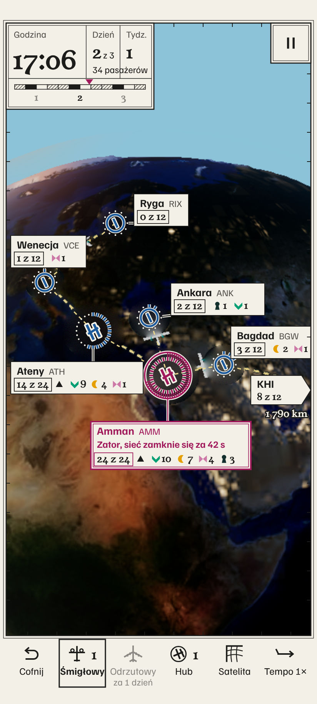
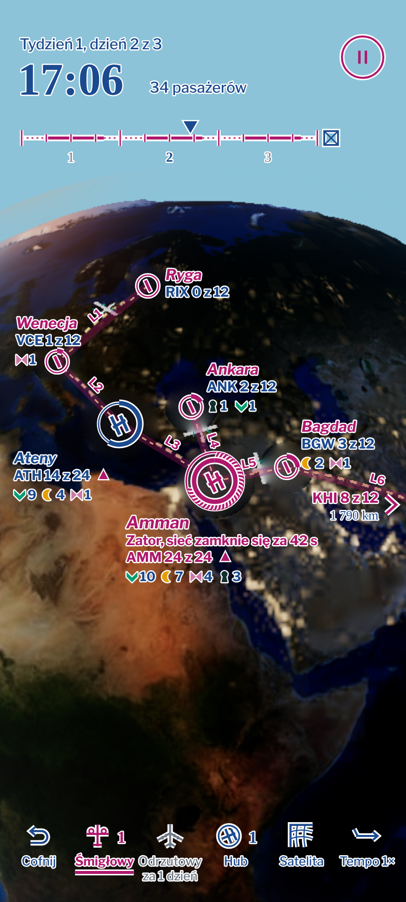
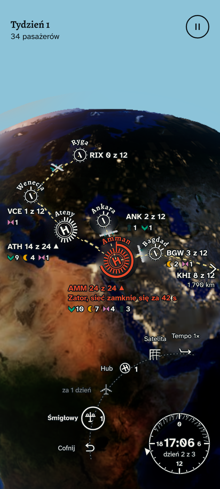

# KARTA v2 — 3 warianty do wyboru

Twoja ocena: „styl karta jest najbliższa tego czego oczekuję, ale dalej zbyt AI Slop”. Pięć rzeczy do poprawy:
(1) ciemne paski u góry i u dołu, (2) typografia (wąskie, rozstrzelone kapitaliki, mono), (3) ikony doku,
(4) przywieszki lotnisk, (5) okrągłe „medaliony” lotnisk na mapie. Każdy wariant poprawia wszystkie pięć i ma
własny pomysł wzięty z prawdziwych map lotniczych (FAA sectional / IFR): symbol lotniska pokazujący układ pasów,
podpisy z obwódką (halo), farby magenta / niebieska / czarna, legenda, tabliczka tytułowa, podziałka, róża kompasowa,
strefy zastrzeżone z kreskowaniem.

**Kadry (PNG 2×)** w `docs/mockups/ui-2026-11/v2/<a|b|c>/`: `game-p.png` (412×915), `game-l.png` (915×412),
`jam.png` (zbliżenie zatoru AMM z przywieszką), `menu-p.png`. Tło: ten sam prawdziwy render gry co w KIERUNKI.md
(seed 0xA1A1), z **wymazanymi medalionami lotnisk** (`clean-frames.py`, wypełnienie z otoczenia), żeby pokazać nowe
znaczniki. Trasy przerywane są dorysowane tylko w wymazanych miejscach. Źródła: `mockups/ui-2026-11/v2/`, render:
`node mockups/ui-2026-11/v2/shoot.mjs`.
Wzorniki: [`docs/references/charts/`](../../references/charts/README.md) (plansza `plansza.png`, PR #256);
numery plansz poniżej to numery wycinków stamtąd (01–16).

### Skąd co wzięte (plansze referencyjne)
| Pomysł z wzorników | A Arkusz | B Nadruk | C Róża |
|---|---|---|---|
| Lotnisko = krążek z sylwetką pasów, hub rośnie geometrią (01, 02, 07) | tak: niebieski krążek z pasem, hub = trzy pasy | tak: magenta krążek, hub = trzy pasy w niebieskim | tak: róża z pasami, hub = podwójny pierścień + trzy pasy |
| Liczba wpisana w pierścień zamiast paska zajętości (02) | kreski miejsc na obwodzie | pierścień grubieje na odcinku zajętym | kreski róży = miejsca |
| Dwie farby nadruku z jasnym halo (08, 09) | niebieski + magenta (alarm) na papierze | **magenta + niebieski**, białe halo | biel + cynober (wariant „nocny”) |
| Trasy jako półprzezroczyste pasy farby z numerem (13, 16) | — | **tak** (pasy magenty L1–L6, propozycja dla render) | — |
| HUD jako tabela linii włosowych „mała etykieta nad dużą liczbą” (06) | **tak**: tabliczka Godzina / Dzień / Tydz. | — (nadruk bez tabeli) | — (tarcza) |
| Dół jako neatline z podziałką czasu (12) | ramka arkusza + podziałka w tabliczce | linia kursu tygodnia (13) | tarcza 24 h = podziałka kołowa (16) |
| Szeryf na tytuły, pochyły grotesk na nazwy lotnisk, liczby w ramkach jak częstotliwości (05, 07) | Young Serif + grotesk, **liczby w ramkach** | **nazwy pochyłym Libre Franklin** + Source Serif na zegar | Alegreya (szeryf) na nazwy, bez ramek |
| Dok jako legenda tą samą kreską (11) | **tak**: legenda w dolnym marginesie | symbole nadrukowane | symbole na łuku róży |
| Odnośnik: prosta ramka + cienka linia (15) | ramki z linią odniesienia | bez ramek (blok danych jak 01) | bez ramek |
| Róża z podziałką (16, 04) | — | — | **cała idea wariantu** |
| Obszar zastrzeżony z kreskowaniem (08: ramki ostrzeżeń, strefy) | zator = obszar zastrzeżony | zator = strefa zakazana | zator = łuk odliczania |

**Wspólne dla A/B/C.** Zero ciemnych pasków. Tekst zdaniową pisownią („Tydzień 1, dzień 2 z 3”, „14 z 24”), bez
rozstrzelenia i bez fontu mono, najmniejszy napis 12,5 px. **Nowy zestaw symboli doku narysowany dla Airway**
(`common.js`, SYM): cofnij = linia kursu zawracająca, śmigłowy = prosty płat z dwiema tarczami śmigieł, odrzutowy =
skośne skrzydło z czterema silnikami, hub = trzy pasy w pierścieniu, satelita = narożnik arkusza z siatką
kartograficzną, tempo = strzałka kursu z „lotkami” jak chorągiewka wiatru (1 lotka = 1×). **Lotnisko = symbol
lotniska z mapy**: zwykłe = pierścień z pasem w środku, hub = układ trzech pasów (kształt, nie kolor, odróżnia hub);
zapełnienie jest rysowane na samym symbolu. Glify pasażerów D-08 bez zmian, pogrupowane z liczbą.
Dok w zasięgu kciuka (dół w pionie, prawa krawędź w poziomie), każdy cel ≥ 48 dp, bezpieczne obszary 24/16 px.

---

## A. Arkusz — ekran to jeden wydrukowany arkusz mapy

Cienki papierowy margines z podwójną ramką (neatline) i znacznikami siatki obejmuje zdjęcie; HUD to elementy
arkusza: **tabliczka tytułowa** w rogu (Airway, tydzień, duży zegar, dzień, pasażerowie, **podziałka czasu** z
blokami po 6 h, noce kreskowane, znacznik „teraz”) i **legenda** w dolnym marginesie jako dok.
1. Paski: zamiast ciemnych pasów jasny margines arkusza (8 px z boków; dół = legenda). 2. Typografia: Young Serif
(zegar, liczby) + Familjen Grotesk (napisy), oba już w repo. 3. Ikony: symbole legendy, wybrany w podwójnej ramce,
niedostępny szary z „za 1 dzień”. 4. Przywieszki: **ramka-odnośnik jak na mapie** (nazwa miasta + kod, „14 z 24”,
trójkąt trendu, glify) z linią odniesienia; prostokąt bez zaokrągleń i cieni. 5. Lotniska: niebieski symbol lotniska
„z wieżą” z obwódką papieru; **kreski wokół = zajęte miejsca**, kropki = wolne. Zator = **obszar zastrzeżony**
(magenta, kreskowanie od środka), długość kreskowania = czas do zamknięcia; ramka odnośnika magenta.
Menu: tabliczka tytułowa rośnie w dolną połowę (Airway, „Mapa sieci lotniczej, arkusz 1”, podziałka 1 : 40 000 000,
pozycje jak wiersze legendy).
Po wzornikach: tabliczka ma układ nagłówka podejścia ILS (06: „Godzina / Dzień / Tydz.” mała etykieta nad dużą
liczbą), a liczba w odnośniku stoi w ramce jak częstotliwość (05).
**Ryzyka:** jasny margines i ramki to nadal płaszczyzny na zdjęciu (wrażenie „naklejki” z DIAGNOZY); dolna legenda
to optycznie wciąż pas, choć jasny i drukowany; białe ramki zasłaniają globus przy wielu lotniskach.

## B. Nadruk — bez paneli, tylko farba na globusie

Wszystko nadrukowane bezpośrednio na zdjęcie dwiema farbami mapy VFR: **magenta + niebieski**, każda litera i symbol z
białą obwódką kartograficzną. Żadnego prostokąta na ekranie.
1. Paski: brak. Zegar 46 px na niebie, pod nim **trasa tygodnia** jak linia kursu: dni ciągłe, noce przerywane,
kreski co 6 h, trójkąt „teraz”, na końcu symbol skrzyni. 2. Typografia: Libre Franklin (grotesk z rodziny krojów
amerykańskich map, nazwy kursywą) + Source Serif 4 (zegar) — dwa nowe kroje OFL. 3. Ikony: te same symbole nadrukowane niebieskim;
wybrany = magenta z podkreśleniem. 4. Przywieszki: **blok danych lotniska jak na mapie**: nazwa, kod + „z”,
glify — bez ramki. 5. Lotniska: magenta; **pierścień grubieje na odcinku zajętych miejsc** (pierścień = wskaźnik).
Zator = **strefa zakazana** z kreskowaniem po obwodzie, długość = czas.
Po wzornikach: druga farba to **niebieski** (08) — huby, nazwy, HUD; nazwy lotnisk **pochyłym groteskiem** (05);
trasy jako **półprzezroczyste pasy magenty z numerem** L1–L6 (13) — to propozycja dla renderu tras (ext).
Menu: pozycje jako punkty trasy na magentowej linii kursu po stronie kciuka.
**Ryzyka:** czarny tekst z białą obwódką na ciemnej nocy wygląda jak kontur — najsłabsza czytelność z trzech;
przy dużej sieci nadruk robi się gęsty (brak tła, które porządkuje); nowe fonty.

## C. Róża — wszystko z róży kompasowej (mój wariant)

Jeden kształt niesie całą grę. **Lotnisko to mała róża**: każda kreska na obwodzie to miejsce w poczekalni (długa =
zajęte), w środku układ pasów, **nazwa biegnie po łuku** jak napis na mapie. **HUD to jedna róża w rogu kciuka**:
tarcza 24 h (noc kreskowana, „heading bug” = teraz, 17:06 i „dzień 2 z 3” w środku), a **dok leży na łuku wokół
niej** — kciuk zatacza łuk, więc przyciski są tam, gdzie kciuk naturalnie sięga. Farba: kredowa biel z ciemną
obwódką na zdjęciu, czerń na niebie; cynober tylko dla zatoru.
1. Paski: brak; tydzień i pasażerowie na niebie, pauza w kółku. 2. Typografia: Alegreya 700 (nazwy miejsc) +
Atkinson Hyperlegible Next (liczby, podpisy; krój dla czytelności) — oba już w repo. 3. Ikony: symbole na łuku,
wybrany w kółku. 4. Przywieszki: nazwa po łuku róży + krótka notka „ATH 14 z 24 ▲” i glify, bez ramki. 5. Lotniska:
róża miejsc zamiast medalionu; hub ma podwójny pierścień i trzy pasy. Zator = róża i nazwa w cynobrze + **gruby łuk
odliczania** wokół.
Menu: duża róża kompasowa, pozycje menu na jej zachodnim łuku (lewy dolny róg pod kciukiem).
**Ryzyka:** napisy po łuku przy małych lotniskach i zoomie trzeba wyważyć (kolizje); łuk doku w poziomie jest
„wycinkiem większej róży” i zajmuje prawą krawędź; róża z dużą liczbą kresek (hub 36+) zagęszcza się — przy dużej
pojemności kreska = 2 lub 3 miejsca.

---

## Zakres wdrożenia
| | A Arkusz | B Nadruk | C Róża |
|---|---|---|---|
| **UI (`src/ui/**`, nasza sesja)**: tokeny, fonty, HUD, dok, przywieszki, menu | duży: margines + tabliczka + legenda, nowy układ przywieszek z liniami odniesienia | średni: same nadruki SVG/CSS z `paint-order` halo, brak paneli | średni–duży: komponent tarczy 24 h, dok na łuku (układ dla pion/poziom/fold), napisy po łuku w nakładce |
| **Fonty** | 0 nowych | +2 (Libre Franklin z kursywą, Source Serif 4) | 0 nowych |
| **Znaczniki lotnisk (`src/render/**`, sesja ext)** | symbol z pierścieniem + pasy, kreski miejsc, obszar zastrzeżony | pierścień-wskaźnik, strefa zakazana | róża miejsc, łuk odliczania |
| Szacunek | 4–5 nocy UI + 2 noce ext | 3 noce UI + 2 noce ext | 4 noce UI + 2–3 noce ext |

Znaczniki lotnisk na makietach to **propozycja projektowa**: dziś rysuje je renderer globusa (`src/render/**`),
który należy do sesji ext; UI może je tylko zamówić (wspólna specyfikacja: kształt, liczba kresek = pojemność,
kolor stanu). Niezależnie od wyboru warto od razu przenieść „ciemne niebo” z DIAGNOZY (też ext).

## Rekomendacja
**C „Róża”.** To jedyny wariant, w którym jeden autorski kształt tłumaczy rozgrywkę na każdym poziomie (miejsca w
poczekalni = kreski róży, doba = tarcza, dok = łuk kciuka) i nic nie leży na zdjęciu jako płaszczyzna — a więc
najdalej od „szablonu UI”. Nie wymaga nowych fontów. Jeśli wolisz bezpieczniej i bliżej obecnej KARTY: **A** (z
jasną legendą zamiast ciemnych pasków). B jest najczystszym „nadrukiem”, ale ma najsłabszą czytelność na nocnej
stronie globusa.

Samokontrola z listą zakazów (CLAUDE.md): brak gradientów fiolet‑niebieski, glassmorphismu, poświaty neonowej,
zaokrąglonych kart z cieniem, emoji i ikon z paczki (wszystkie symbole narysowane w `common.js`), żaden wariant nie
używa jednego kroju systemowego. Typy pasażerów i hub odróżnia kształt.
