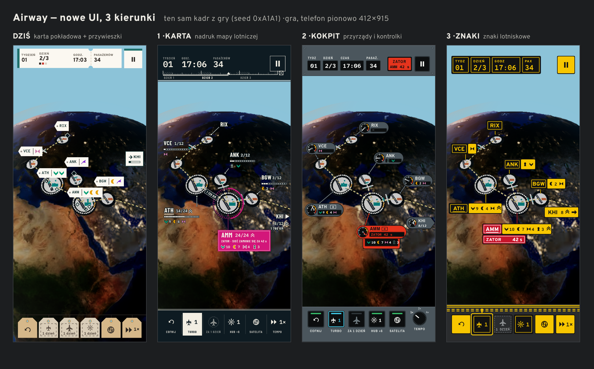
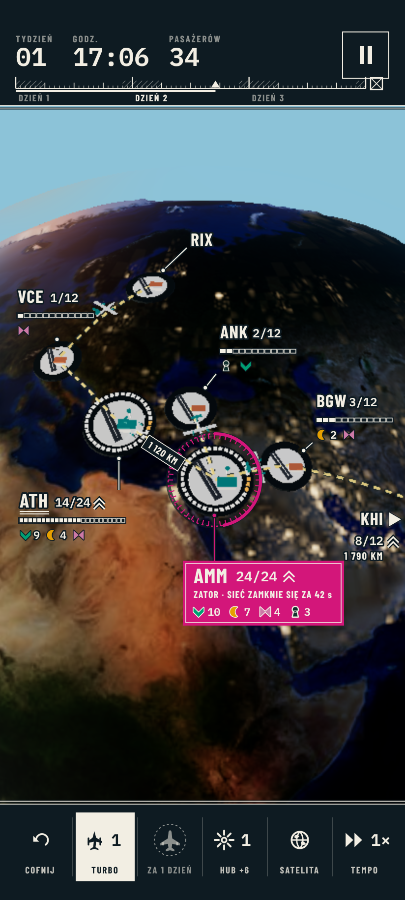
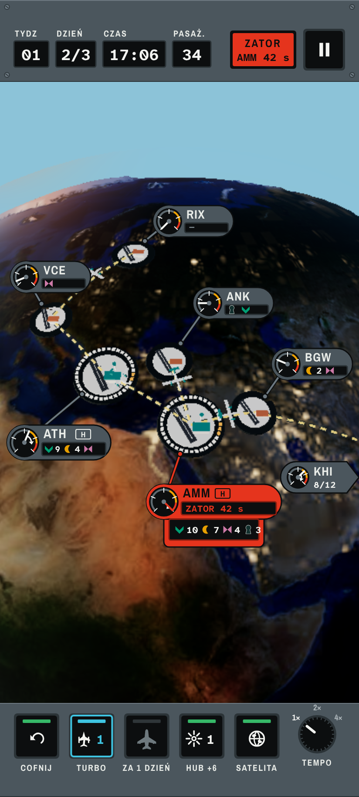
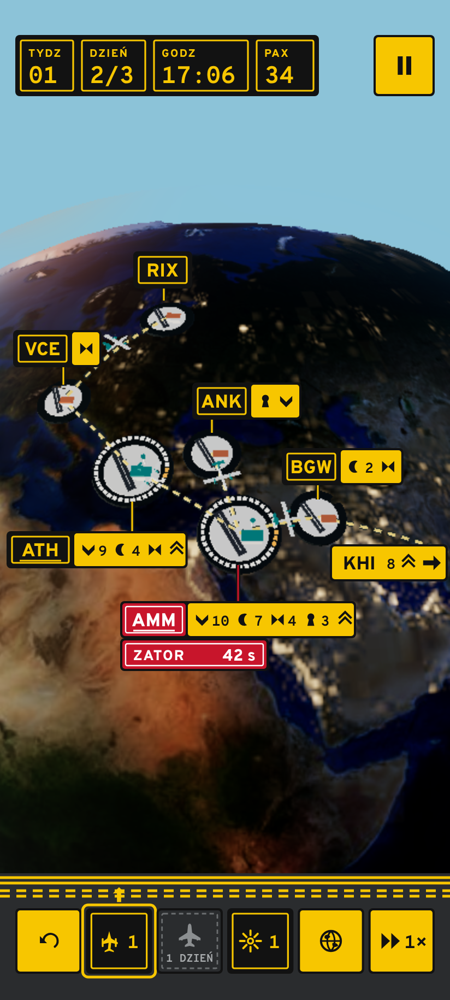

# Nowe UI pod satelitarny globus: 3 kierunki do wyboru

Pozostałe zestawienia: [poziomo](../../mockups/ui-2026-11/zestawienie-game-l.png),
[menu główne](../../mockups/ui-2026-11/zestawienie-menu-p.png). Pojedyncze kadry (PNG 2×):
`docs/mockups/ui-2026-11/<karta|kokpit|znaki>/{game-p,game-l,menu-p}.png`. Co dziś nie gra: [DIAGNOZA.md](DIAGNOZA.md).

**Jak powstały.** Tło każdego kadru to ten sam prawdziwy render gry z `dev` (seed 0xA1A1, `storeShot=game` i
`storeShot=menu`, UI ukryte), więc globus, płyty lotnisk i trasy są identyczne, a różni się tylko UI. Wszystkie
kierunki pokazują ten sam stan: tydzień 1, dzień 2/3, 17:06, 34 pasażerów; ATH (hub) zapełnia się, **AMM (hub)
ma zator**, KHI jest poza ekranem (w pionie), turbośmigłowiec jest wybrany, szerokokadłubowiec przyjdzie za dzień.
Bezpieczne obszary: 24 px u góry i 16 px u dołu w pionie, 40/24 px z boków w poziomie. Każdy przycisk ma co
najmniej 48 dp. Źródła HTML: `mockups/ui-2026-11/`, render: `node mockups/ui-2026-11/shoot.mjs`.

**Wspólne dla wszystkich trzech.** Dok jest na dole w pionie i z prawej w poziomie (zasięg kciuka), pauza zostaje
w rogu. Glify pasażerów zostają z D-08; na przywieszce są **pogrupowane z liczbą** (⌄10 ☾7 ⋈4) zamiast powtarzania
symboli, bo przy 24 osobach rząd glifów był nieczytelny. Zator ma własny, nie do pomylenia kształt, a nie tylko
czerwony licznik. Nic nie wymaga zmian w `src/render/**` ani w symulacji.

---

## 1. KARTA — nadruk mapy lotniczej

**Idea.** UI to nadruk mapy nawigacyjnej położony na zdjęciu satelitarnym. Ekran ma marginesy jak arkusz mapy
(ciemna „nocna” mapa z ramką i podziałką), a na globusie są tylko napisy z obwódką kartograficzną, linie odniesienia,
podziałki i symbole. Prawie żadnych kart: jedynym wypełnionym kształtem na całym ekranie jest zator.

**Jak tłumaczy rozgrywkę.**
- **Linijka tygodnia** u góry: trzy dni po 24 godziny, noce zakreskowane (cisza nocna), znacznik „teraz”, a na końcu
  symbol skrzyni. Jednym rzutem oka widać, ile zostało do skrzyń i kiedy przyjdzie noc.
- **Podziałka pod kodem lotniska**: jeden segment na miejsce w poczekalni, wypełnione = zajęte (ATH 14/24).
- **Zator = strefa zastrzeżona**: wokół huba rysuje się okrąg z kreskowaniem, jak obszar zakazany na mapie; gruby
  łuk na okręgu to czas do zamknięcia sieci. Pod spodem jedyny pełny, magentowy blok z licznikiem.
- **Lotnisko poza ekranem** to notka na krawędzi „KHI ▸ 8/12, 1 790 km”, jak odsyłacz do sąsiedniego arkusza.
- Trasy mogą dostać etykietę odległości („1 120 KM”), co pomaga przy zasięgu samolotów.

**Paleta.** Atrament `#0E1B22` (marginesy), farba drukarska `#F2EEE3` (litery, linie), magenta mapy `#D3167A`
tylko dla zatoru i ostrzeżeń. Glify pasażerów zachowują kolory D-08.
**Typografia.** Barlow Condensed 500/700 (litery mapy, kapitaliki z rozstrzeleniem), IBM Plex Mono 400/600 (liczby).
**Kształty.** Linie włosowe 1 px, ostre narożniki, podwójna ramka (neatline), obwódka liter zamiast tła.

**Ryzyka.** Cienkie litery z obwódką na jasnej pustyni w pełnym słońcu i na 320 px trzeba zmierzyć (D-47).
Linie odniesienia wymagają nowego układu przywieszek (`overlay-layout.ts`) i większej ilości miejsca. Kierunek
„mapy” był odrzucony jako **świat** gry (D-05, „Mapa pilota”); tu świat zostaje fotograficzny, mapą jest tylko UI.
**Zakres w `src/ui/**`:** średni–duży. `hud/boarding-pass.ts` → pasek z linijką tygodnia, `hud/tag-dock.ts` +
`hud.css` → listwa legendy, `overlay.ts`/`overlay.css` → podpisy z obwódką, podziałka, symbol strefy zastrzeżonej
(SVG w nakładce DOM, bez renderu 3D), `overlay-layout.ts` → linie odniesienia, `menu/` → tabliczka tytułowa,
`theme/` + `fonts.css` (2 nowe kroje), potem tablica skrzyń, raport i ustawienia w tym samym języku. Szacunek: 4–6 nocy.

## 2. KOKPIT — przyrządy i kontrolki

**Idea.** Ekran to widok z kabiny: szara blacha paneli u góry i u dołu obramowuje globus jak szyba. Każde lotnisko
ma mały **przyrząd** z zapełnieniem, a dok to rząd podświetlanych przycisków i pokrętło tempa. Kolory działają jak w
prawdziwym kokpicie i zawsze znaczą to samo: biały normalnie, bursztyn ostrzeżenie, czerwony alarm, błękit wybrane.

**Jak tłumaczy rozgrywkę.**
- **Wskaźnik zapełnienia** przy każdym lotnisku: strzałka na skali z łukiem szarym, bursztynowym i czerwonym; im
  bliżej czerwieni, tym bliżej zatoru. Widać to bez czytania liczb.
- **Trend zapełnienia (D-221)** to wektor trendu jak na prędkościomierzu: łuk ze strzałką pokazuje, dokąd wskazówka
  pójdzie w następnej godzinie.
- **Lampka „ZATOR AMM 42 s”** w górnym panelu działa jak master warning: świeci, gdy jakiś hub się zapycha, a dotknięcie
  przenosi kamerę na ten hub.
- **Lampki nad przyciskami**: zielona = dostępne, błękitna = wybrane, zgaszona = jeszcze nie ma (szerokokadłubowiec
  za 1 dzień). Tempo to pokrętło z trzema pozycjami 1×/2×/4×.
- **Menu jako komputer pokładowy (CDU)**: czarny ekran z pozycjami przy klawiszach z boku (48 dp, w zasięgu kciuków).

**Paleta.** Szary panel `#4B565D` z jaśniejszą i ciemniejszą krawędzią (bez cieni), czarna tarcza `#0C0E0F`, biel
`#F3F4F1`, bursztyn `#F0A202`, czerwień `#E5341D`, zieleń `#36B868`, błękit `#3EC3E0`. Kolory płaskie, bez poświaty.
**Typografia.** Archivo Narrow 500/700 (grawerowane etykiety), Atkinson Hyperlegible Mono 400/700 (odczyty;
krój zaprojektowany dla czytelności, kuzyn obecnego Atkinsona).
**Kształty.** Okrągłe tarcze, prostokątne przyciski z lampką, wkręty w rogach paneli, pokrętło.

**Ryzyka.** Najcięższy wizualnie: dwa szare panele zabierają ok. 20% wysokości ekranu w pionie. Łatwo przejść w
„gamingowy HUD” (trzeba pilnować: zero poświaty, płaskie lampki). Małe tarcze (r 15 px) są na granicy czytelności przy
320 px. Najbliżej „Not ATC” z CLAUDE.md — trzeba pilnować, żeby gra nie zaczęła wyglądać na symulator.
**Zakres w `src/ui/**`:** duży. Nowy komponent tarczy (SVG) w `overlay.ts` z animacją wskazówki, `hud/` przebudowany
na panele, lampka zatoru (nowe zdarzenie z istniejącego stanu jam), pokrętło tempa w `tag-dock.ts`, menu jako CDU
(`menu/`), tablica skrzyń i raport do przerobienia na ekrany przyrządów. Szacunek: 6–8 nocy.

## 3. ZNAKI — znaki lotniskowe

**Idea.** UI mówi prawdziwym kodem znaków na płycie lotniska. Czarny znak z żółtym napisem i ramką = **gdzie
jesteś** (lokalizacja), żółty z czarnym napisem i strzałką = **dokąd** (kierunek), czerwony z białym = **stój**
(obowiązkowy). Pasażerowie czekający na lotnisku są wypisani jak **tablica kierunków**: każde lotnisko ma czarny znak
z kodem i obok żółty znak z celami podróży.

**Jak tłumaczy rozgrywkę.**
- **Lotnisko = zestaw znaków**: [ATH] + [⌄9 ☾4 ⋈ ⇈]. Czarny znak to miejsce, żółty to dokąd ludzie chcą lecieć.
- **Zator = znak obowiązkowy**: kod robi się czerwony i pod spodem pojawia się czerwony znak „ZATOR 42 s”. Czerwień
  jest zarezerwowana tylko dla tego.
- **Lotnisko poza ekranem** to żółty znak kierunku ze strzałką „KHI 8 ⇈ →”.
- **Linia oczekiwania (hold short)**: dwie ciągłe i dwie przerywane żółte linie oddzielają świat od doku, tak jak na
  płycie oddzielają drogę kołowania od pasa. Wybrany samolot ma żółtą ramkę i strzałkę „w stronę świata”.
- Dok: akcje (cofnij, widok globusa, tempo) to żółte znaki, zasoby (samoloty, hub) to czarne znaki z liczbą.
- **Menu**: tablica kierunków ze strzałkami („← LOT BEZ KOŃCA”, „ZADANIA ↗”, „DZIŚ 04.11 →”) pod dużym znakiem AIRWAY.
  Rozwija najmocniejszy element obecnego UI (żółty drogowskaz).

**Paleta.** Żółć znaków `#F7C600`, czerń `#121212`, czerwień `#C8152B`, biel, asfalt `#2A2C2E` pod dokiem.
**Glify pasażerów są na znakach czarne** (kształt niesie region, D-08 mówi, że kolor tylko wzmacnia): kolorowe glify
na żółtym (pomarańczowy półksiężyc!) były nieczytelne.
**Typografia.** Overpass 800 (wywodzi się z Highway Gothic, czyli kroju znaków drogowych) i Overpass Mono 700:
oba kroje są już w grze, więc zero nowych fontów.
**Kształty.** Prostokątne panele z lekkim zaokrągleniem 2,5 px, czarna obudowa, grube strzałki jak na znakach.

**Ryzyka.** Najgłośniejszy: dużo żółci na ekranie konkuruje z globusem, przy wielu lotniskach może wyglądać jak
plac budowy (trzeba ograniczyć żółte znaki do lotnisk z pasażerami i ewentualnie zmniejszyć je przy oddaleniu).
Czarne glify zamiast kolorowych zmieniają nawyk gracza (kolor zostaje na samolotach i w legendzie). Najbliżej
dzisiejszego menu, więc mniejsza „nowość”.
**Zakres w `src/ui/**`:** mały–średni. Przywieszki w `overlay.ts`/`overlay.css` to wciąż prostokąty obok lotniska
(ten sam układ kolizji), tylko nowy wygląd i grupowanie glifów; `hud/` i `tag-dock.ts` to zmiana CSS i ikon; menu
zostaje tablicą, ale bez klapek split‑flap; fonty bez zmian. Szacunek: 2–3 noce.

---

## Porównanie

| | 1 Karta | 2 Kokpit | 3 Znaki |
|---|---|---|---|
| Pasuje do zdjęcia Ziemi | najlepiej (nadruk na zdjęciu to tradycja kartografii) | dobrze (szyba kabiny) | średnio (głośne) |
| Zostawia miejsce globusowi | najwięcej | najmniej | średnio |
| Czytelność stanu na 1 rzut oka | dobra (magenta = tylko zator) | bardzo dobra (tarcze) | bardzo dobra (kod kolorów) |
| Oryginalność | wysoka | średnia (kokpit to częsty motyw) | wysoka |
| Koszt wdrożenia | 4–6 nocy | 6–8 nocy | 2–3 noce |
| Nowe fonty | 2 (Barlow Condensed, IBM Plex Mono) | 2 (Archivo Narrow, Atkinson Hyperlegible Mono) | 0 |

## Rekomendacja Claude: **1 KARTA**
Globus jest teraz fotografią i to on ma być bohaterem; Karta jest jedynym kierunkiem, który **dokłada mniej niż
zabiera**: zamiast kart są litery i linie, a jedyną pełną plamą koloru na ekranie jest zator, więc oko od razu wie, co
jest ważne. Nadruk mapy na zdjęciu satelitarnym to prawdziwy, spójny język (mapy lotnicze, mapy na ortofotach), a nie
kostium. Linijka tygodnia, podziałka miejsc i strefa zastrzeżona tłumaczą trzy mechaniki (noc, pojemność, zator)
bez jednego dodatkowego słowa. Warunek: przed wdrożeniem pomiar kontrastu liter z obwódką na jasnej pustyni (D-47) i
próba na 320 px. Jeśli wolisz tańszą i odważniejszą drogę, druga w kolejności jest **3 Znaki**.

Wybór kierunku zapiszę jako nową decyzję w `docs/DECISIONS.md`; to Twoja decyzja stylu, więc w tym PR nie ma numeru D.
